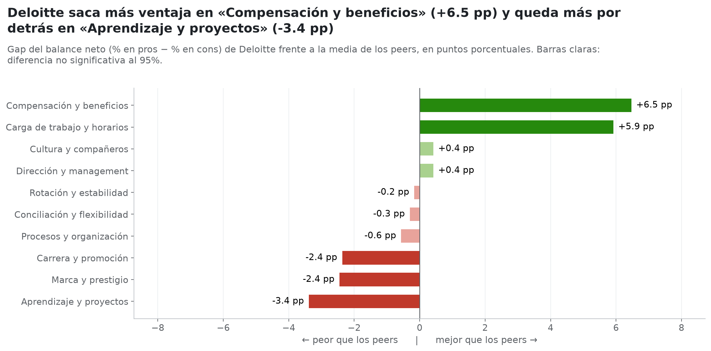
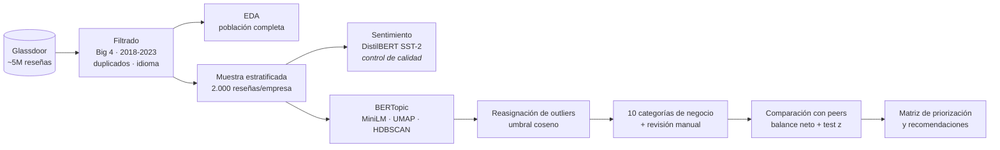
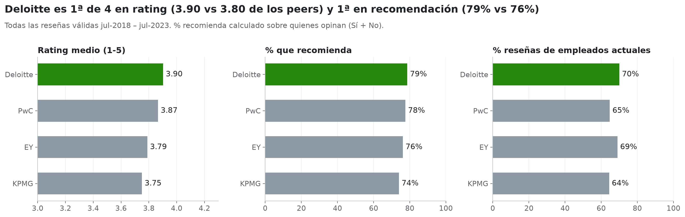
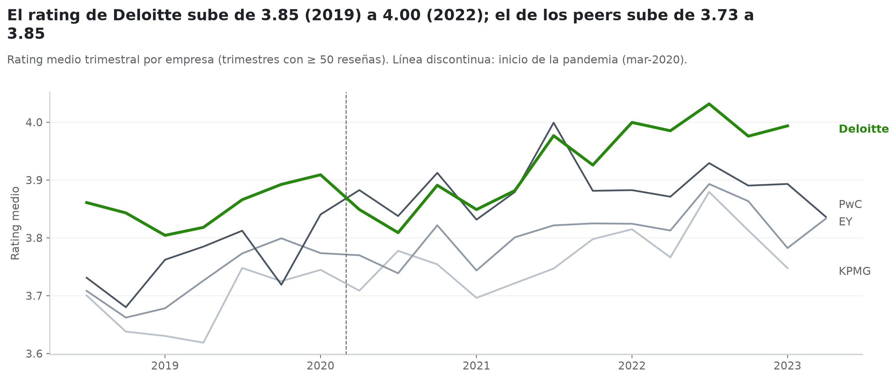
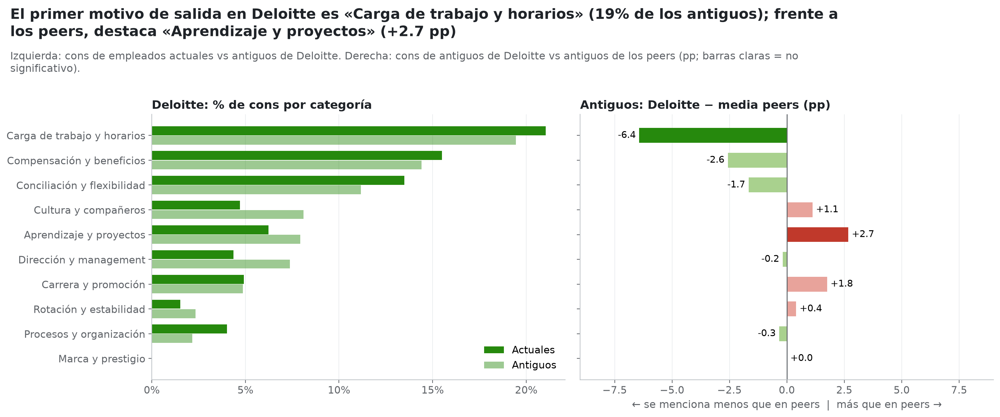
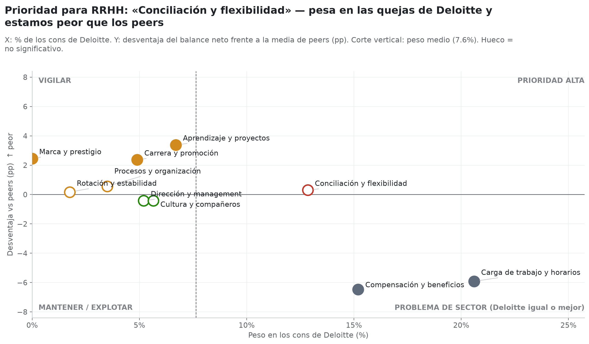
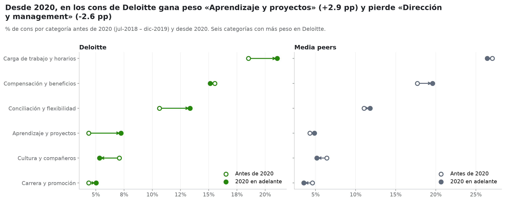
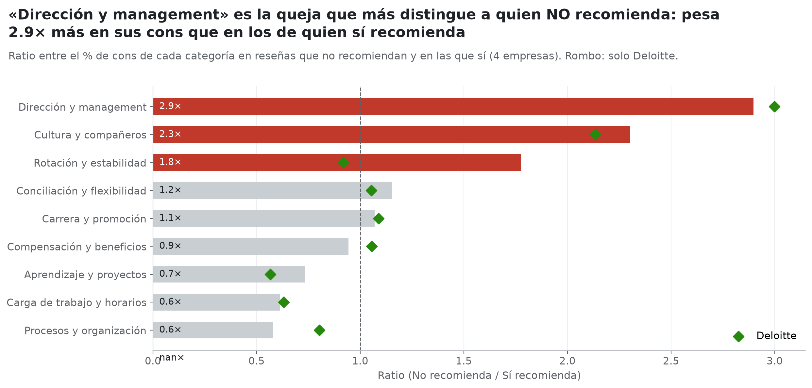

<div align="center">

# 🟢 Diagnóstico de marca empleadora · Deloitte vs. Big 4

**NLP sobre reseñas de Glassdoor para decirle a RRHH qué explotar y qué arreglar, siempre comparado con la competencia.**


</div>

---

## 📌 El encargo

RRHH quiere saber dos cosas:

1. **Puntos fuertes** de Deloitte como empleador, para usarlos en *employer branding* y selección.
2. **Áreas de mejora** que dañan su reputación o provocan salidas.

La regla del análisis es que **un problema solo es prioritario si Deloitte está peor que el mercado**. Por eso todo se compara con **PwC, EY y KPMG**, las otras tres Big 4, que compiten por el mismo perfil de graduado.

<div align="center">

| | Deloitte | PwC | EY | KPMG |
|---|:---:|:---:|:---:|:---:|
| Reseñas (jul 2018 – jul 2023) | **40.187** | 33.546 | 31.629 | 25.749 |
| Rating medio | **3,90** 🥇 | 3,87 | 3,79 | 3,75 |
| % recomienda (sobre quienes opinan) | **78,6%** 🥇 | 77,5% | 76,2% | 74,0% |

</div>

---

## ✨ Resultados en 30 segundos

> **Deloitte es la Big 4 mejor valorada y su ventaja se ha ampliado desde 2022.** No hay una crisis que apagar: el reto es defender el liderazgo y corregir las debilidades antes de que crezcan.

| 💪 Fortalezas (gap de balance neto vs. peers) | ⚠️ Debilidades |
|---|---|
| **Compensación y beneficios** · **+6,5 pp** | **Aprendizaje y proyectos** · **−3,4 pp**: es el motivo de salida diferencial y se ha duplicado desde 2020 |
| **Carga de trabajo** más llevadera que en el sector · **+5,9 pp** | **Carrera y promoción** · **−2,4 pp**: pesa mucho en quienes llevan más de 5 años |
| **Empleados actuales** muy satisfechos (3,99 ★ y 82% recomienda) | **Marca y prestigio** · **−2,4 pp**: se cita menos como orgullo |

**🎯 Tres recomendaciones para RRHH**

1. **Proyectos que hagan crecer:** rotación y asignación transparente de proyectos, con un seguimiento periódico de *"¿estoy aprendiendo?"*.
2. **Carrera clara para los perfiles con experiencia:** criterios de promoción y de calibración públicos a partir del tercer año.
3. **Contar lo que ya hacemos mejor:** campañas de captación con testimonios reales sobre compensación, beneficios y equipos, en lugar de apoyarse solo en el prestigio de la marca.

> 💡 **Dato clave:** lo que más rompe la recomendación son las quejas de **dirección (2,9×)** y **cultura (2,3×)**, no las horas. Deloitte está en línea con el mercado en ambas y mantenerlo es condición necesaria para todo lo demás.

<p align="center">
  
</p>

---

## 🧠 Pipeline



| Paso | Qué se hace | Por qué |
|---|---|---|
| **Sentimiento** | `distilbert-base-uncased-finetuned-sst-2-english` sobre pros y cons | Comprueba que los datos son coherentes: el **94,7%** de los pros sale positivo y el **81,3%** de los cons negativo. Los casos discordantes se analizan y se convierten en señal (p. ej. *"No cons, great place to work"*). |
| **Topics** | BERTopic con embeddings `all-MiniLM-L6-v2`, UMAP y HDBSCAN | Salen **47 topics en pros y 50 en cons**. |
| **Outliers** | Se reasignan al tema más parecido solo si la similitud coseno supera el percentil 10 de los miembros legítimos | Los "sin tema" bajan del **28,8% al ~9%** sin forzar etiquetas. |
| **Categorías** | Propuesta automática por palabras clave y **revisión manual** con palabra de control | Cada categoría corresponde a una palanca de RRHH distinta. Se corrigieron 12 topics en pros y 7 en cons. |
| **Comparación** | **Balance neto** = % en pros − % en cons, frente a la media simple de los peers, con test z al 95% | Evita la trampa de los porcentajes relativos y separa la señal del ruido. |

---

## 📊 Galería

<table>
  <tr>
    <td><br><sub><b>1.1</b> Visión general por empresa</sub></td>
    <td><br><sub><b>1.3</b> Evolución del rating</sub></td>
  </tr>
  <tr>
    <td><br><sub><b>5</b> Motivos de salida (antiguos)</sub></td>
    <td><br><sub><b>6.1</b> Matriz de priorización</sub></td>
  </tr>
  <tr>
    <td><br><sub><b>7.1</b> Antes y después de 2020</sub></td>
    <td><br><sub><b>7.3</b> Qué quejas rompen la recomendación</sub></td>
  </tr>
</table>

En `figuras/` están las 13 figuras del análisis, y en `figuras/slides/` sus versiones para la presentación.

---

## 🗂️ Estructura

```
proyecto_dl/
├── Diagnostico_Deloitte_Glassdoor.ipynb   # 📓 Notebook principal (análisis completo y conclusiones)
├── Caso_Practico_NLP_Glassdoor_RRHH.pdf   # 📄 Enunciado del caso práctico
├── glassdoor_reviews_hr.parquet           # 💾 Dataset de reseñas (Git LFS)
├── lista_con_sector.xlsx                  # 🏢 Empresas y su sector
├── figuras/                               # 📊 Gráficos del análisis
│   └── slides/                            #     Versiones para la presentación
└── resultados/
    ├── metricas.json                      # 🔢 Todas las cifras clave (alimentan la presentación)
    ├── muestra_etiquetada.parquet         # 🏷️ Muestra con sentimiento, topic y categoría
    ├── topics_pros.csv                    # 🟢 Topics de pros → categoría
    └── topics_cons.csv                    # 🔴 Topics de cons → categoría
```

---

## 🚀 Cómo ejecutarlo

```bash
# 1. Clonar y bajar el dataset (está en Git LFS)
git clone https://github.com/JoseMasiaTormo/proyecto_dl.git && cd proyecto_dl
git lfs install && git lfs pull

# 2. Entorno
python -m venv .venv && source .venv/bin/activate
pip install pandas numpy matplotlib pyarrow openpyxl scikit-learn torch \
            transformers sentence-transformers bertopic umap-learn hdbscan jupyter

# 3. Abrir el notebook
jupyter notebook Diagnostico_Deloitte_Glassdoor.ipynb
```

**En Google Colab:** sube `glassdoor_reviews_hr.parquet` a `/content` (o cambia `DATA_PATH`). La primera celda instala lo que falte.

| ⚙️ Parámetro | Valor | Para qué sirve |
|---|---|---|
| `TARGET` / `PEERS` | `Deloitte` / `PwC, EY, KPMG` | Cambia la empresa analizada o sus competidores |
| `FECHA_INI`, `FECHA_FIN` | jul 2018 – jul 2023 | Ventana temporal |
| `MAX_POR_EMPRESA` | 2.000 | Tamaño de la muestra para los modelos |
| `REDUCIR_SIN_GPU` | `False` | Con `True` baja a 1.000 reseñas por empresa si no hay GPU |
| `SEED` | 42 | Reproducibilidad |

⏱️ **Tiempo:** unos minutos con GPU y ~15-20 min en CPU la primera vez. Después se usa la caché de `cache/`, que se invalida sola si cambia la muestra.

---

## ⚠️ Limitaciones

- **Glassdoor no es la plantilla:** opinan sobre todo los muy satisfechos y los muy descontentos.
- **Mezcla de países y de líneas de servicio** (Reino Unido, India, auditoría, consultoría...), que puede explicar parte de las diferencias entre firmas.
- **Un tema por reseña**, un ~9-10% queda sin clasificar y aparecen algunos topics "de empresa".
- **Muestra de 2.000 por firma:** las diferencias de menos de ~2-3 pp no son significativas (por eso se marcan). Antes de 2020 solo hay ~350 reseñas por empresa.
- **Sentimiento binario y solo en inglés**, entrenado con críticas de cine. Se usa únicamente como control de calidad.
- **Correlación, no causalidad:** hay que contrastarlo con datos internos (entrevistas de salida, rotación, eNPS).

---

<div align="center">
<sub>Proyecto de Deep Learning · NLP aplicado a RRHH · Hecho por <a href="https://github.com/JoseMasiaTormo">José Masiá Tormo</a></sub>
</div>
